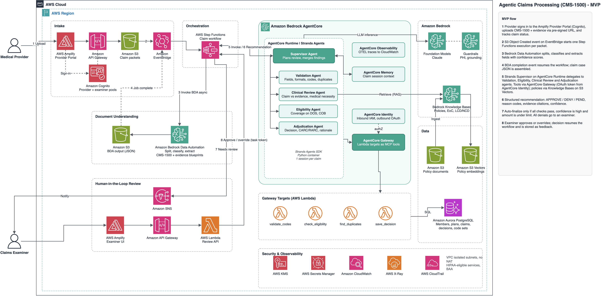
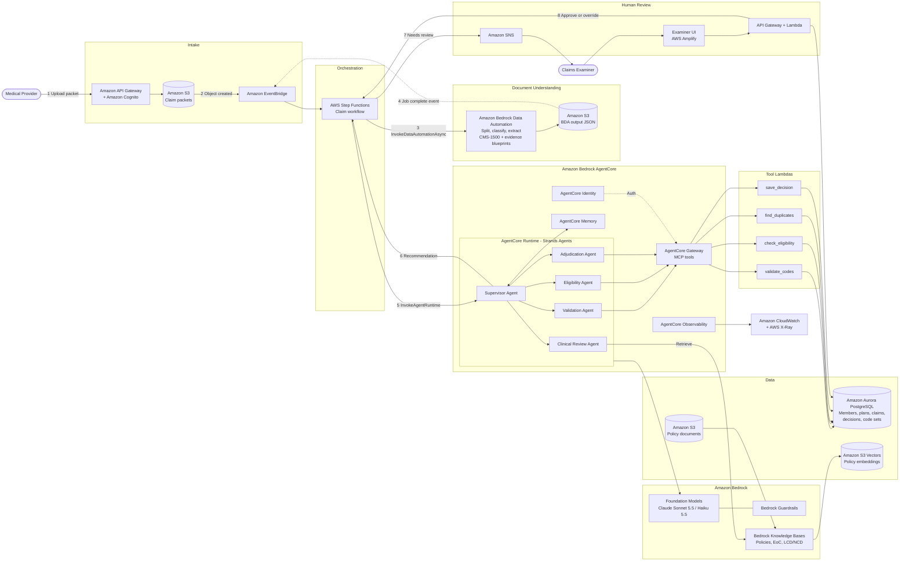

# Agentic Claims Processing (CMS-1500) – MVP High-Level Design

## Scope (MVP)

Intake and classification, CMS-1500 and evidence extraction, data-quality checks, member eligibility,
claim-vs-evidence reconciliation, medical necessity, adjudication recommendation, and human-in-the-loop review.

Out of scope for MVP: provider/NPI registry verification, prior-auth matching, NCCI edits, FWA/duplicate
analytics beyond exact match, pricing, RFI letters, EOB/835 generation, appeals.

## Architecture Diagram

Editable source: [`c_agentic_claims_mvp_architecture.drawio`](../../assets/architectures/c_agentic_claims_mvp_architecture.drawio). Simplified Mermaid version:

Text alternative: a provider uploads a claim packet to S3, which triggers a Step Functions workflow. The workflow
sends the packet to Bedrock Data Automation, then gives the extracted data to a Strands supervisor agent hosted on
AgentCore Runtime. Specialist agents call business tools through AgentCore Gateway (Lambda over Aurora) and policy
retrieval through Bedrock Knowledge Bases. The recommendation goes back to Step Functions, which either finalizes
the claim or pauses for an examiner decision.

## End-to-End Flow

| # | Step | Detail |
|---|------|--------|
| 1 | Submit | Provider signs in to the **Provider Portal** (AWS Amplify, Cognito provider user pool), uploads the CMS-1500 plus evidence (PDF, images) via an API Gateway pre-signed S3 URL, and tracks claim status. |
| 2 | Trigger | An S3 `Object Created` event on EventBridge starts a Step Functions execution, one per claim packet. |
| 3 | Extract | Step Functions calls BDA async with a project holding the blueprints: CMS-1500, medical record / progress note, op note, lab report, primary payer EOB. BDA splits and classifies the packet and returns per-field values with confidence scores. |
| 4 | Normalize | BDA output lands in S3; the completion event resumes the workflow, and a Lambda step assembles a single claim case JSON (header, service lines, evidence facts, confidence scores). |
| 5 | Agentic review | Step Functions calls the AgentCore Runtime endpoint. The Strands **Supervisor** delegates, using agents as tools, to the specialists below. |
| 6 | Recommend | The Supervisor returns a structured decision: `APPROVE / DENY / PEND`, line-level CARC/RARC codes, a rationale, evidence citations (document, page, text) and an overall confidence. |
| 7 | Route | A routing step auto-finalizes only when all checks pass, confidence is at or above the threshold, and the amount is under the limit. **All denials and low-confidence or high-dollar claims go to a human.** |
| 8 | Human review | A `waitForTaskToken` step pauses the workflow; SNS notifies examiners; the examiner UI shows the fields, the evidence and the agent's reasoning; the examiner's decision resumes the workflow and is stored as feedback. |
| 9 | Document parts | Pack versus single document is derived from BDA output. Each segment becomes a row in `claim_document_parts` (type, page range, S3 key). PDF packs are cut into page-range PDFs in the BDA output bucket; the UI lists parts and opens them through pre-signed URLs of 300 seconds or less. |
| 10 | Additional documents | While a claim is in progress the provider uploads more files. A separate state machine (`ClaimDocumentBatchWorkflow`, triggered by `batches/{claim_id}/{batch_id}/submit.json`) runs BDA, waits for any active review, merges the evidence into the case without replacing the form or lines, and re-runs the agent review. `PENDING_REVIEW` re-reviews in place, `PENDED_INFO_REQUESTED` reopens the claim, finalized claims only record the documents. The claim page polls for status. |
| 11 | Re-run review | An examiner can re-run only the agent review on the stored case (`POST /reviews/{claimId}/rerun`, mandatory reason). The claim state machine starts at the agent step through an `entry` Choice. Allowed from `PENDING_REVIEW`, `FAILED` (with a stored case) or `PENDED_INFO_REQUESTED` (`final_decision = PEND`) when no document batch is in flight; `APPROVED` and `DENIED` claims are never re-run. Re-running a pended claim clears the PEND (kept in the decision history under the earlier run). The waiting execution is stopped and its token cleared. A re-run always goes to a human. Runs are numbered per claim (`claims.current_run`, `claim_runs`, `claim_run_id` on `agent_runs` and `decisions`); old parts, extractions, runs and decisions are never deleted. |

## Agent Design (Strands Agents on AgentCore Runtime)

| Agent | Responsibility | Tools | Model |
|-------|----------------|-------|-------|
| Supervisor | Plans the review, calls the specialists, merges their findings into the final structured output | Specialist agents (as tools), AgentCore Memory | Claude Sonnet 5.5 (`us.anthropic.claude-sonnet-5-5`) |
| Validation | Required fields, formats (NPI check digit, dates), ICD-10/CPT/POS/modifier validity, exact duplicates | `validate_codes`, `find_duplicates` | Claude Haiku 5.5 (`us.anthropic.claude-haiku-5-5`) |
| Eligibility | Member match, coverage active on date of service, plan benefits, coordination of benefits (boxes 9, 11d) | `check_eligibility` | Claude Haiku 5.5 (`us.anthropic.claude-haiku-5-5`) |
| Clinical Review | Reconcile each billed line against the evidence; check diagnosis-to-procedure medical necessity against policy | Bedrock KB `retrieve` | Claude Sonnet 5.5 (`us.anthropic.claude-sonnet-5-5`) |
| Adjudication | Apply plan rules to the findings, set line decisions and reason codes, persist the result | `save_decision` | Claude Sonnet 5.5 (`us.anthropic.claude-sonnet-5-5`) |

Design choices:
- **Step Functions handles the deterministic steps** (extraction, retries, the human-review pause, SLAs); **agents handle the reasoning**. Each part is easier to audit and retry this way.
- **Structured output**: every agent returns a Pydantic-typed result (Strands `structured_output`), so downstream steps never parse free text.
- **Grounding**: the Clinical Review agent must cite evidence for every finding; Guardrails contextual grounding checks reject unsupported claims.

## AgentCore Components

| Component | Use in MVP |
|-----------|------------|
| Runtime | Hosts the Strands multi-agent app as a container; one session per claim; isolated microVM per session. |
| Gateway | Exposes the tool Lambdas as MCP tools; inbound CUSTOM_JWT authorizer (dedicated Cognito M2M pool, scope check); one place for tool authorization and request logging. |
| Identity | Inbound: IAM SigV4 from the workflow Lambda (with a runtime user id). Outbound: OAuth2 credential provider (Cognito client credentials) issues Gateway tokens to the runtime's workload identity. |
| Memory | Short-term: claim session context across agent calls. Long-term (later): examiner override patterns. |
| Observability | OTEL traces of agent steps, tool calls and token usage to CloudWatch / X-Ray. |

## Security and Compliance (PHI)

- All services HIPAA-eligible; a BAA must be in place.
- KMS customer-managed keys for S3, Aurora, Step Functions, SNS, logs and AgentCore Memory/Gateway. S3 Vectors (non-PHI policy embeddings) use SSE-S3.
- Aurora in isolated subnets with no ingress; Lambdas use the IAM-authorized RDS Data API, so no NAT or database network path exists.
- Bedrock Guardrails: PII masking in outputs and logs, denied topics, contextual grounding.
- Least-privilege IAM role per agent / tool; CloudTrail on; S3 versioning and object lock on the claims and decisions buckets.
- Audit record per claim: inputs, BDA job ID, agent trace ID, model IDs, prompts version, decision, examiner action.

## MVP Success Metrics

- Field-level extraction accuracy on CMS-1500 (target 95% or better on key boxes)
- Straight-through-processing rate
- Examiner overturn rate of agent recommendations
- Median end-to-end processing time per claim
- Cost per claim (BDA pages + model tokens)

## Reuse from Existing Claims Review Guidance

- BDA project / blueprint creation Lambdas (`deployment/lambda/claims_review/blueprint_creation`, `invoke_data_automation`)
- EoC sample documents (knowledge base now on S3 Vectors, so `create_vector_index` is no longer needed)
- Aurora member/plan schema (`manage_schema`)
- Replace the Bedrock Agent + action groups (`claims_review_agent_actions`, `invoke_verification`) with Strands agents on AgentCore Runtime plus Gateway tools.

## Implementation

The MVP is implemented in [`v2/`](../../v2/README.md) as a separate CDK stack (`agentic-claims-v2`, default Region
us-west-2). Two changes from the first draft of this design:

- **Vector store:** Amazon S3 Vectors replaces OpenSearch Serverless.
- **Gateway OAuth:** a dedicated Cognito machine-to-machine pool, with the token fetched through an AgentCore Identity
  OAuth2 credential provider.
