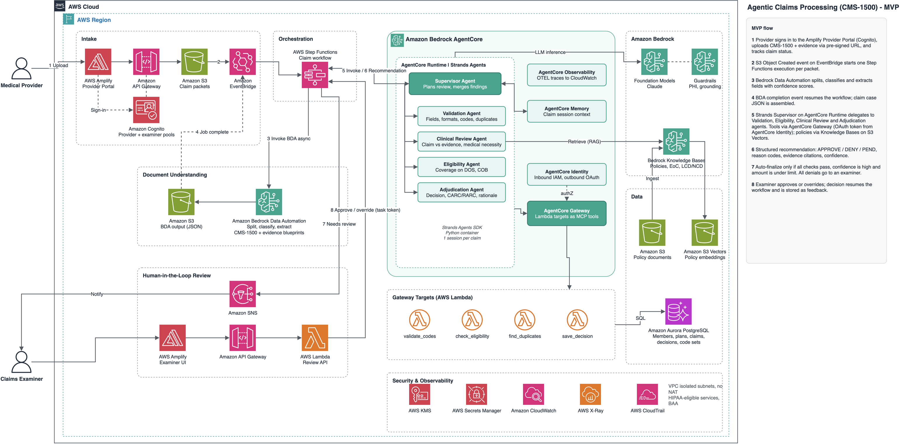

# Agentic CMS-1500 Claims Processing (v2)

Multi-agent claims review for CMS-1500 professional claims and their supporting evidence, built with
**Amazon Bedrock Data Automation** (extraction), **Strands Agents** (agent framework) and **Amazon Bedrock AgentCore**
(Runtime, Gateway, Identity, Memory, Observability). It runs as a separate stack next to the original `claims-review`
guidance in `../deployment` and shares nothing with it.



Design: [`deployment/docs/c_agentic_claims_01_mvp_design.md`](../deployment/docs/c_agentic_claims_01_mvp_design.md) ·
editable diagram: [`c_agentic_claims_mvp_architecture.drawio`](../assets/architectures/c_agentic_claims_mvp_architecture.drawio)

## How it works

1. A provider signs in to the **Provider Portal** (Amplify Hosting, Cognito with MFA), uploads a CMS-1500 and
   evidence through pre-signed S3 URLs and submits the claim.
2. The `submit.json` marker triggers the **Step Functions** workflow through EventBridge.
3. **BDA** splits and classifies every document and extracts fields with confidence scores, using four blueprints:
   CMS-1500, medical record, lab/imaging report and primary payer EOB.
4. The workflow assembles a claim case and invokes the **Strands supervisor** on **AgentCore Runtime**. The supervisor
   calls four specialist agents in order:
   - **Validation** (Haiku): codes, NPIs, totals, duplicates.
   - **Eligibility** (Haiku): member, coverage on dates of service, COB.
   - **Clinical Review** (Sonnet): claim vs. evidence, medical necessity, plan coverage from the **Knowledge Base**
     on **S3 Vectors**, with citations.
   - **Adjudication** (Sonnet): line decisions with CARC/RARC codes.

   Tools sit behind **AgentCore Gateway**. The runtime obtains OAuth tokens for the Gateway (Cognito client
   credentials) from **AgentCore Identity**.
5. Deterministic guards run over the LLM output:
   - An approval with any failed check becomes PEND.
   - Low extraction confidence caps the confidence score.
   - A claim is auto-finalized only if it is APPROVE, all checks passed, confidence ≥ 0.9 and the amount is under
     the plan limit.
   - **Every denial or pend goes to a human.**
6. The **Examiner UI** shows the documents, extracted fields with confidence, findings with citations and the line
   decisions. The examiner's decision resumes the workflow through a task token and is recorded in the audit trail.
7. **Packs and parts.** Whether an upload is one document or a pack is decided from the BDA output (number of
   segments), never from what the provider declares. Each BDA segment is stored as a row in `claim_document_parts`
   (type, page range, S3 location). For a PDF pack, the assemble step cuts one page-range PDF per segment into the
   BDA output bucket (`claims/{claim_id}/parts/...`). Single documents and images reuse the uploaded object. If a PDF
   cannot be cut, the part points at the original with a start page. The Documents table lists parts only.
8. **Additional documents.** While a claim is in progress, the provider can upload more files from the claim page.
   Each upload batch runs in its own state machine (`ClaimDocumentBatchWorkflow`, triggered by
   `batches/{claim_id}/{batch_id}/submit.json`): BDA, wait until no other review is running, merge the evidence into
   the case, then re-run the agent review. The claim form and service lines are never replaced. Merge behavior
   depends on the claim status: `PENDING_REVIEW` re-reviews in place and notifies examiners, `PENDED_INFO_REQUESTED`
   reopens the claim through the same auto/human routing, and a claim that is already approved, denied or failed
   only records the documents.
9. **Re-run review (Mode A).** An examiner can re-run only the agent review, for example after a prompt, model or
   `max_tokens` change, or when the agent step failed. `POST /reviews/{claimId}/rerun` with `{mode: "AGENT", reason}`
   starts the claim state machine at the agent step with the stored `claims/{claim_id}/case.json`. BDA is not called
   again and `claim_document_parts` and `extractions` are not changed. Each claim has a run number
   (`claims.current_run`, 1 = original submission). Agent runs and decisions carry it as `claim_run_id`, and the
   request (who, when, mode, reason, outcome) is stored in `claim_runs`. Old runs, recommendations and decisions are
   kept. A re-run is always routed to a human, never auto-finalized. The reason is required (10 to 1000 characters),
   is stored only in `claim_runs`, and is not logged, audited in detail or sent in notifications. If the claim waits
   for an examiner, the old execution is stopped and its task token is cleared before the new run starts.

## Repository layout

| Path | Contents |
|------|----------|
| `infra/` | CDK (Python) app, stack `agentic-claims-v2`; Lambda handlers in `infra/lambdas/`; tests in `infra/tests/` |
| `agents/` | Strands multi-agent app (container for AgentCore Runtime), prompts, unit tests |
| `web/` | React + Vite + Amplify UI single-page app (provider and examiner areas) |
| `db/` | Aurora PostgreSQL schema and demo seed data |
| `blueprints/` | BDA custom blueprints |
| `scripts/` | `create_user.sh`, `load_policy_docs.sh`, `smoke_test.py` |

## Prerequisites

- An AWS account and Region with Bedrock Data Automation, AgentCore and the configured Claude models. The default is
  **us-west-2**; set `region` and `availability_zones` in `infra/cdk.json` to change it.
- **Bedrock model access** to the inference profiles in `infra/cdk.json` (`reasoning_model_id`, `fast_model_id`) and
  to `amazon.titan-embed-text-v2:0`. Check the IDs in your account first:
  `aws bedrock list-inference-profiles --region us-west-2 --query "inferenceProfileSummaries[?contains(inferenceProfileId,'claude')].inferenceProfileId"`
- Python 3.12+, Node.js 22 or 24, AWS CLI v2.
- **Docker or Finch running.** CDK builds the ARM64 agent image locally. With Finch: `finch vm start` and
  `export CDK_DOCKER=finch`.
- The account and Region bootstrapped for CDK: `npx cdk bootstrap aws://ACCOUNT/us-west-2`.
- Because the stack processes PHI, your account needs a signed AWS Business Associate Addendum (BAA), and you should
  use HIPAA-eligible services only.

## Deploy

```bash
# 1. Web app (the stack deploys web/dist to Amplify Hosting)
cd v2/web && npm ci && npm run build && cd ..

# 2. Infrastructure
cd infra
python3 -m venv .venv && source .venv/bin/activate
pip install -r requirements-dev.txt
npm ci                                  # pins the CDK CLI version
npx cdk synth                           # runs cdk-nag (AWS Solutions + HIPAA Security)
npx cdk deploy agentic-claims-v2
```

The first deploy takes about 20–30 minutes (Aurora, image build, Amplify deployment). It also loads the sample
Evidence of Coverage PDFs into the policy bucket and starts the first knowledge base ingestion. The stack outputs
`AppUrl`, `ApiUrl`, `UserPoolId` and the other identifiers the scripts use.

Optional `cdk.json` settings: `examiner_notification_email` (SNS email for review requests), the
`auto_approve_*` thresholds, `review_timeout_days` and `removal_policy` (`destroy` for demos, `retain` for anything
real; `retain` also enables deletion protection).

## Use it

```bash
cd v2/scripts
./create_user.sh provider provider@example.com PRV-1001   # PRV-1001 / PRV-1002 are seeded providers
./create_user.sh examiner examiner@example.com
```

1. Open `AppUrl` and sign in with the temporary password Cognito emailed. You must set a new password and register a
   TOTP authenticator (MFA is required).
2. As the provider, submit `assets/data/claims_review/cms_1500/sample1_cms-1500-P.pdf`. You can also add a medical
   record PDF as evidence. A single file may hold several documents.
3. As the examiner, open the review queue. The sample forms carry NPI `1234567890`, which fails the CMS check digit,
   so expect an `INVALID_NPI` finding and a human review.

4. On **My Claims**, open the claim. **Documents** lists each document with type, pages, whether it was added later and
   its status. **View** opens it in a dialog (the link is fetched fresh on every open and expires after 5 minutes).
   While the claim is in progress (or the examiner pended it), **Add documents** uploads up to 10 more files. The page
   refreshes itself (every 5 s while something is processing, every 15 s while awaiting an examiner) and shows the
   stage of the upload batch.

To exercise the whole backend without the UI:

```bash
python3 scripts/smoke_test.py            # needs operator credentials with lambda:InvokeFunction
```

The smoke test first checks that every API route returns **401** to anonymous callers. It then submits sample 1,
waits for the agent recommendation, approves it as an examiner, and checks the final status.

## Security notes

- **User access:**
  - Self sign-up is disabled and MFA is required.
  - The API Gateway Cognito authorizer covers every route.
  - Lambda handlers enforce groups (`providers` / `examiners`) and limit providers to their own `custom:provider_id`.
  - The web client cannot change `custom:provider_id`.
- **Service-to-service:**
  - Step Functions → Lambda → AgentCore Runtime uses IAM (SigV4).
  - Runtime → Gateway uses OAuth JWTs, verified by the Gateway for issuer, client and scope.
  - Gateway → Lambda uses the Gateway's IAM role.
  - The `save_decision` tool only writes to claims currently in `AGENT_REVIEW`.
- **Data:**
  - Aurora sits in isolated subnets with no ingress and is reached only through the RDS Data API.
  - S3 buckets block public access, require TLS, are versioned and use the customer-managed KMS key; pre-signed
    URLs expire after 5 minutes.
- **No PHI in logs:**
  - Step Functions logs at ERROR level without execution data.
  - API Gateway has no data tracing.
  - SNS notifications carry only the claim ID and a link.
- **Guardrails:** the Bedrock Guardrail masks SSNs and card or bank numbers in model outputs and blocks prompt
  attacks embedded in documents.
- **Public surface:** the Amplify-hosted SPA shell has no data in it; all data sits behind the authenticated API.
- **cdk-nag:** every acknowledged finding has a stated reason in `infra/agentic_claims/nag.py`. Review them before
  production, in particular secret rotation, WAF logging, backup plans and replication.

## Test

```bash
cd v2/agents && python3 -m venv .venv && .venv/bin/pip install -e ".[dev]" && .venv/bin/pytest
cd v2/infra && .venv/bin/pytest            # Lambda unit tests + CDK security assertions
cd v2/web && npm run lint && npm run build
```

## Clean up

```bash
cd v2/infra && npx cdk destroy agentic-claims-v2
```

With `removal_policy: destroy`, the buckets, database and logs are deleted along with the stack. Deleting them is
irreversible, so use `retain` for any data you need to keep.

## Limits of this MVP

- Reference code sets and plan data are small demo subsets; well-formed codes outside them are only warnings.
- No provider credentialing, prior-authorization matching, NCCI edits, pricing, EOB/835 generation or appeals.
- An additional-documents batch never replaces the claim form. A CMS-1500 inside a batch is stored as a document only.
- One batch merges at a time. A batch waits behind the main workflow or another batch for up to about 1 hour, then fails
  without changing the claim.
- With `PENDING_REVIEW`, an examiner who decides while the re-review runs may see the earlier recommendation.
- Claims processed before parts existed show one row per uploaded file. Part boundaries for real packs depend on the
  BDA segment output; confirm with one multi-document pack after deploy.
- Re-run is Mode A only (agent review). A claim can be re-run from `PENDING_REVIEW`, `FAILED` (with a stored case) or
  `PENDED_INFO_REQUESTED` (`final_decision = PEND`, which means "more information needed"), with no additional-documents
  batch in flight. `APPROVED` and `DENIED` claims cannot be re-run. Re-running a pended claim clears the PEND so the
  new run can finalize on its own result; the original PEND stays in the decision history under run 1. If the new run
  cannot be started, a pended claim returns to `PENDED_INFO_REQUESTED`. A claim that failed during extraction has no
  stored case and cannot be re-run. `run_id` columns on `claim_document_parts` and `extractions` are reserved for a later
  re-extraction mode and are always 1 today.
- Policy retrieval filters knowledge base passages by plan name in the document file name.
